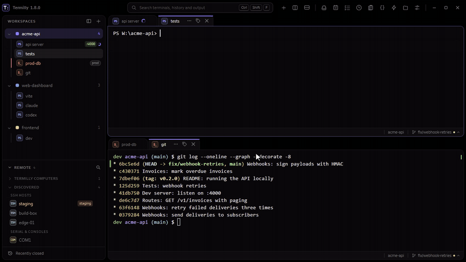
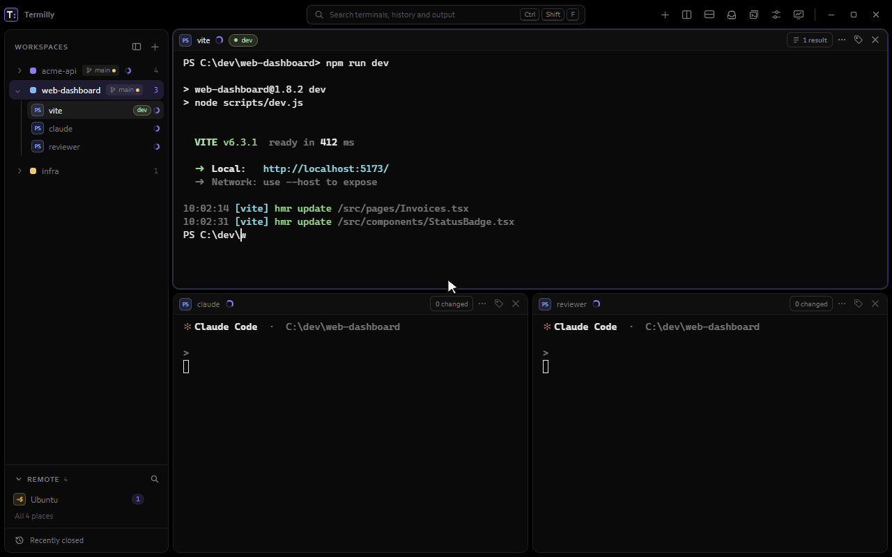
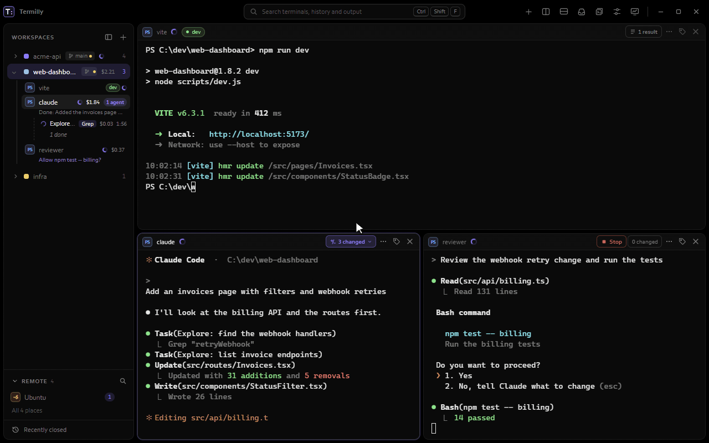
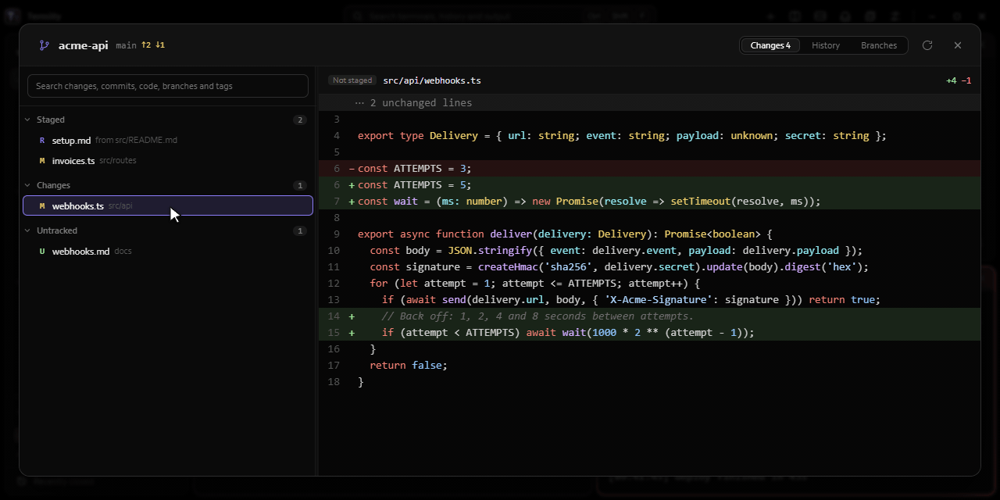

<p align="center"></p>

<h1 align="center">Termilly</h1>

<p align="center"><b>Every shell. One window.</b><br>
Termilly groups your terminals into workspaces, brings them back after a restart with their output, and shows you which coding agent is waiting on you.</p>

<p align="center">
  <a href="https://termilly.com"></a>
  <a href="https://termilly.com/features/"></a>
  <a href="https://termilly.com/docs/"></a>
</p>

<p align="center">
  <a href="https://termilly.com/downloads/latest/TermillySetup.exe"></a>
  <a href="https://termilly.com/downloads/latest/Termilly-arm64.dmg"></a>
  <a href="https://termilly.com/downloads/latest/Termilly-x64.dmg"></a>
  <a href="https://termilly.com/downloads/latest/termilly_amd64.deb"></a>
</p>

<p align="center">
  <a href="https://github.com/termilly/termilly/releases/latest"></a>
  <a href="https://termilly.com/downloads/"></a>
  <a href="LICENSE"></a>
  <a href="https://github.com/termilly/termilly/actions/workflows/ci.yml"></a>
</p>

<p align="center">
  <a href="https://www.producthunt.com/products/termilly?utm_source=badge-follow&utm_medium=badge&utm_source=badge-termilly" target="_blank"></a>
  <a href="https://www.reddit.com/r/termilly/"></a>
</p>

<p align="center"><a href="https://termilly.com"></a></p>

## What it does

- **Workspaces.** Terminals grouped by project, each with its own folder, shells and layout: tabs, splits and docked panes.
- **Comes back after a restart.** Workspaces, terminals and their scrollback return as you left them, encrypted on disk. With "Keep shells running" on, closing or updating the window doesn't end the shells at all.
- **Coding agents in view.** Claude Code's and Codex's state (working, waiting for you, done) shows in the sidebar and the title bar, with a notification when one needs you. A status bar under each terminal has the model, usage, cost and git branch.
- **Views for agents.** Follow an agent one line per step, or see only your prompts and its answers. Set a terminal aside without closing it.
- **Change preview.** Every file an agent edits, with its diff, while it works.
- **To do.** Task lists for workspaces, terminals and SSH hosts. An agent implements a task, another reviews it, and it comes back to you for review.
- **Schedules.** Commands, snippets and agent prompts on a schedule, with reports and notifications.
- **Remote.** Your workspaces, terminals and agents from your phone or another computer.
- **The Git window.** Changes, history and branches for the folder you're in, with one search across changed files, commits and the code they added.
- **One search for everything.** Terminals, command history and output, from one box.
- **Every shell.** PowerShell, cmd, Git Bash, WSL, SSH (with your `~/.ssh/config`), serial ports and network consoles, side by side.
- **Snippets, tags and production guards.** Saved commands with optional variables, and a red frame around terminals tagged prod.
- **Scriptable.** A `termilly` command and an MCP server, so scripts and agents can use your terminals, To do, schedules and Notepad.

<p align="center">
  
  
  
</p>

## Download

Windows 10 (1903 or later) and 11, macOS 15 or later, and Debian or Ubuntu (24.04 or later), 64-bit:

- **Windows:** [TermillySetup.exe](https://termilly.com/downloads/latest/TermillySetup.exe) (full, works offline) or [TermillySetup-online.exe](https://termilly.com/downloads/latest/TermillySetup-online.exe) (downloads .NET and WebView2 only if they're missing).
- **Mac:** [Termilly-arm64.dmg](https://termilly.com/downloads/latest/Termilly-arm64.dmg) (Apple silicon) or [Termilly-x64.dmg](https://termilly.com/downloads/latest/Termilly-x64.dmg) (Intel).
- **Debian and Ubuntu:** [termilly_amd64.deb](https://termilly.com/downloads/latest/termilly_amd64.deb), then `sudo apt install ./termilly_amd64.deb`.

Checksums are in [SHA256SUMS](https://termilly.com/downloads/latest/SHA256SUMS). The Windows installers are code-signed, and the Mac apps are signed and notarized by Apple.

## Build from source

You need the [.NET 10 SDK](https://dotnet.microsoft.com/download) and, for the checks, Node.js 24.

**Windows** (the WebView2 runtime comes with Windows 11 and current Windows 10):

```powershell
dotnet build Termilly.slnx
dotnet run --project src/Termilly.Desktop
```

**Linux** (Ubuntu 24.04; WebKitGTK 4.1 for the window; on a Mac, the same `dotnet run` without the `apt` line):

```sh
sudo apt install dotnet-sdk-10.0 libwebkit2gtk-4.1-0
dotnet run --project src/Termilly.Linux
```

**Tests and checks:**

```sh
dotnet test Termilly.slnx                    # on Linux: dotnet test tests/Termilly.Core.Tests
npm ci
npm run check                                # lint, types, JavaScript tests, generated files, sizes, copies
```

**Installers:** `installer/build.ps1` builds the Windows setup (see [installer/README.md](installer/README.md)), `installer/linux/build-deb.sh` the .deb (see [installer/linux/README.md](installer/linux/README.md)), and `installer/mac/build-app.sh` the Mac .dmg files.

## How it's built

A .NET host with the UI in a web view: WPF and WebView2 on Windows, Photino with WebKitGTK on Linux and WebKit on macOS. The page is plain JavaScript modules (no framework, no bundler) on [xterm.js](https://xtermjs.org). Terminals run in ConPTY on Windows and pseudo terminals on Linux and macOS.

- `src/Termilly.App`: the code every platform runs: services, features, the phone server.
- `src/Termilly.Desktop`: the Windows app and the page (`wwwroot/`).
- `src/Termilly.Linux`: the Linux and macOS app.
- `src/Termilly.Pty`: pseudo terminals for every system.
- `src/Termilly.Host`: the background host that keeps shells running while the window is closed.
- `src/Termilly.Agent`: the `termilly` command, its MCP server, and the hooks agents call.
- `docs/`: design notes and the [coding standards](docs/coding-standards.md).

## Contributing

Bug reports and ideas are welcome in [Issues](https://github.com/termilly/termilly/issues). Before a pull request, please read [CONTRIBUTING.md](CONTRIBUTING.md): contributors sign a short [CLA](CLA.md). Security problems go through [private reporting](SECURITY.md), not public issues.

## License

Termilly is licensed under the [Apache License 2.0](LICENSE). It includes third-party components under their own licenses: see [THIRD-PARTY-NOTICES.md](THIRD-PARTY-NOTICES.md).

Termilly is an independent project, not affiliated with or endorsed by Anthropic. "Claude" and "Claude Code" are Anthropic's products and trademarks; Termilly works with them.
