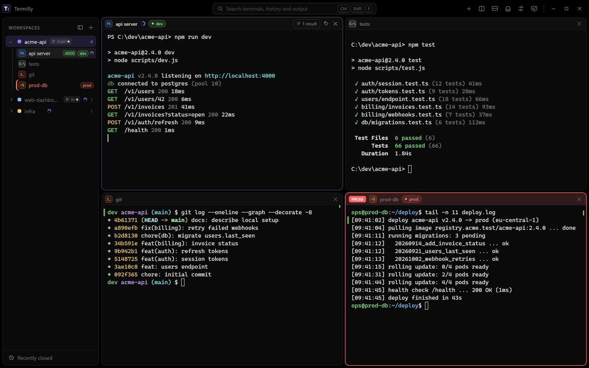
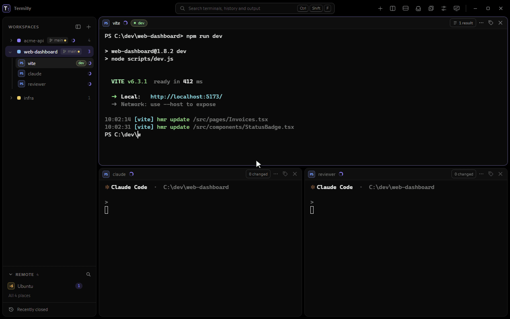
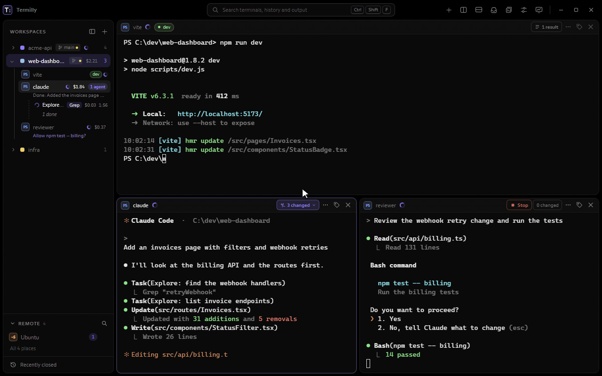
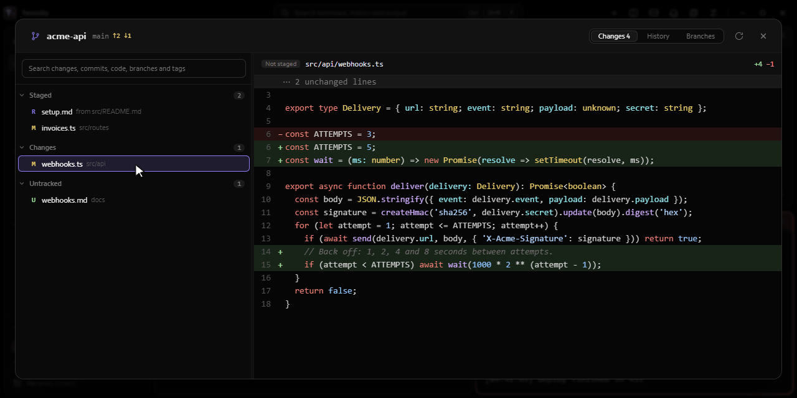

<p align="center"></p>

<h1 align="center">Termilly</h1>

<p align="center"><b>Every shell. One window.</b><br>
Termilly groups your terminals into workspaces, brings them back after a restart with their output, and shows you which coding agent is waiting on you.</p>

<p align="center"><a href="https://termilly.com">termilly.com</a> · <a href="https://termilly.com/downloads/">Download</a> · <a href="https://termilly.com/docs/">Docs</a></p>



## What it does

- **Workspaces.** Terminals grouped by project, each with its own folder, shells and layout: tabs, splits and docked panes.
- **Comes back after a restart.** Workspaces, terminals and their scrollback return as you left them, encrypted on disk. With "Keep shells running" on, closing or updating the window doesn't end the shells at all.
- **Coding agents in view.** Claude Code's state (working, waiting for you, done) shows in the sidebar and the title bar, with a notification when one needs you.
- **Change preview.** Every file an agent edits, with its diff, while it works.
- **The Git window.** Changes, history and branches for the folder you're in, with one search across changed files, commits and the code they added.
- **One search for everything.** Terminals, command history and output, from one box.
- **Every shell.** PowerShell, cmd, Git Bash, WSL, SSH (with your `~/.ssh/config`), serial ports and network consoles, side by side.
- **Snippets, tags and production guards.** Saved commands with optional variables, and a red frame around terminals tagged prod.
- **Scriptable.** A `termilly` command and an MCP server, so scripts and agents can open terminals, read output and set a status.

<p align="center">
  
  
  
</p>

## Download

Windows 10 (1903 or later) and 11, and Debian or Ubuntu (24.04 or later), 64-bit:

- **Windows:** [TermillySetup.exe](https://termilly.com/downloads/latest/TermillySetup.exe) (full, works offline) or [TermillySetup-online.exe](https://termilly.com/downloads/latest/TermillySetup-online.exe) (downloads .NET and WebView2 only if they're missing).
- **Debian and Ubuntu:** [termilly_amd64.deb](https://termilly.com/downloads/latest/termilly_amd64.deb), then `sudo apt install ./termilly_amd64.deb`.

Checksums are in [SHA256SUMS](https://termilly.com/downloads/latest/SHA256SUMS). The Windows installers aren't code-signed yet, so SmartScreen may warn the first time.

## Build from source

You need the [.NET 10 SDK](https://dotnet.microsoft.com/download) and, for the checks, Node.js 24.

**Windows** (the WebView2 runtime comes with Windows 11 and current Windows 10):

```powershell
dotnet build Termilly.slnx
dotnet run --project src/Termilly.Desktop
```

**Linux** (Ubuntu 24.04; WebKitGTK 4.1 for the window):

```sh
sudo apt install dotnet-sdk-10.0 libwebkit2gtk-4.1-0
dotnet run --project src/Termilly.Linux
```

**Tests and checks:**

```sh
dotnet test Termilly.slnx                    # on Linux: dotnet test tests/Termilly.Core.Tests
npm ci
npm run check                                # lint, types, JavaScript tests, generated files, sizes, copies
```

**Installers:** `installer/build.ps1` builds the Windows setup (see [installer/README.md](installer/README.md)), and `installer/linux/build-deb.sh` the .deb (see [installer/linux/README.md](installer/linux/README.md)).

## How it's built

A .NET host with the UI in a web view: WPF and WebView2 on Windows, Photino and WebKitGTK on Linux. The page is plain JavaScript modules (no framework, no bundler) on [xterm.js](https://xtermjs.org). Terminals run in ConPTY on Windows and pseudo terminals on Linux.

- `src/Termilly.Desktop`: the app, its page (`wwwroot/`) and the code Linux shares.
- `src/Termilly.Linux`: the Linux window.
- `src/Termilly.Pty`: pseudo terminals for both systems.
- `src/Termilly.Host`: the background host that keeps shells running while the window is closed.
- `src/Termilly.Agent`: the `termilly` command, its MCP server, and the hooks agents call.
- `docs/`: design notes and the [coding standards](docs/coding-standards.md).

## Contributing

Bug reports and ideas are welcome in [Issues](https://github.com/termilly/termilly/issues). Before a pull request, please read [CONTRIBUTING.md](CONTRIBUTING.md): contributors sign a short [CLA](CLA.md). Security problems go through [private reporting](SECURITY.md), not public issues.

## License

Termilly is licensed under the [Apache License 2.0](LICENSE). It includes third-party components under their own licenses: see [THIRD-PARTY-NOTICES.md](THIRD-PARTY-NOTICES.md).

Termilly is an independent project, not affiliated with or endorsed by Anthropic. "Claude" and "Claude Code" are Anthropic's products and trademarks; Termilly works with them.
